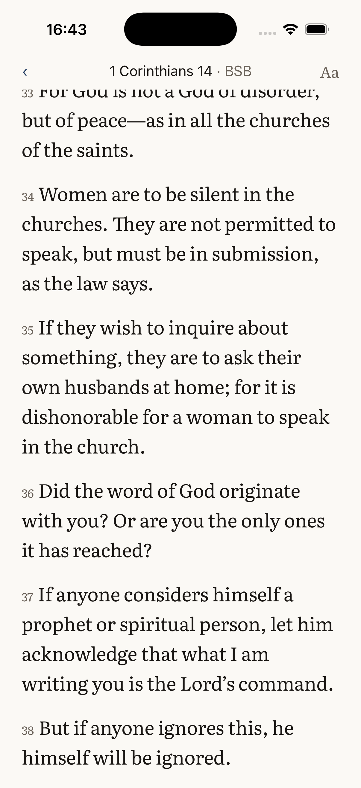
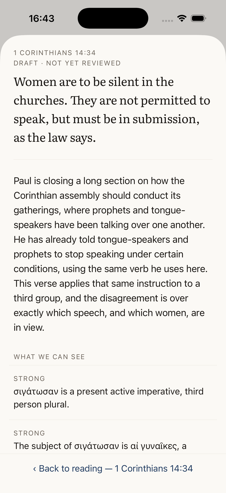
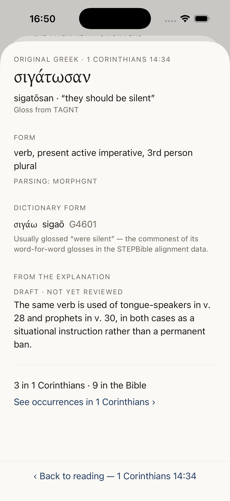

# Yada

A Bible reader for iPhone that explains one passage at a time, in plain words, with the original Greek and Hebrew a tap away. It's for people who read the Bible on their own and find it hard to make sense of. I designed it and directed the build with Claude Code, as a side project.

**Website:** [yadabible.com](https://yadabible.com) · **Beta:** on Apple TestFlight (join from the website)

  
  
  

## Why I made it

It started with my own reading. I wanted to study the Bible more deeply, and what opened it up for me was seeing a single verse broken down: the original words, and the context around it, like what was happening at the time and how things worked then. When I went back to the Bible apps I used, none of them supported reading that way, and I kept noticing small UX fixes I wanted to make.

I'm not alone in finding it hard. Lifeway Research found in 2020 that 57% of Protestant churchgoers find the Bible hard to make sense of on their own. Yada is built for that reader: read the passage, get the point in plain words, and go as deep as you want from there.

## Key design decisions

**Listen like you read song lyrics.** When I listened to the Bible, I'd lose focus for a moment and then struggle to find my place again. Music apps already solve this with synced lyrics, so Yada borrows that pattern: as the audio plays, each word lights up, so you can always see where you are and find your place again. That meant building the word-by-word highlighting from scratch rather than from ready-made components, and a lot of work making the narration sound natural rather than robotic.

**Plain words first, depth on request.** Every passage opens with what it says in everyday language. The original language, word forms and cross-references are one tap further in, so a new reader isn't overwhelmed and a curious one is never blocked.

**Where Christians disagree, Yada says so.** Some verses are read more than one way by faithful readers. Instead of picking a side, Yada sets out each reading from its source and leaves the choice to the reader. 1 Corinthians 14:34, shown above, is one example.

**Every explanation has a named source.** The explanations come from openly licensed scholarship, and each one says where it's from. If a reader wants to check, they can.

**Every word of the original, with its form.** Tap a word to see the Greek or Hebrew, what it means, its grammar, and how often it appears in that book and the whole Bible. Search a name like Nicodemus and Yada finds the person, the Greek word and every passage they appear in.

**A habit that forgives you.** A day counts when you read or listen. One day of rest a week never breaks the streak, and if it stops, it simply starts again the next day you read. Missing a day shouldn't feel like failing.

**Private and offline by default.** The Bible text lives on the phone, so it works without signal. There's no account and nothing is collected. Bookmarks and your reading place sync through your own iCloud.

**Built for every reader.** Text goes up to the largest accessibility size, in light or dark, and listening helps people who find reading hard.

## Sources and licences

Every text, dataset and font in Yada is public domain or openly licensed. `sources.manifest.json` lists each one with its licence and the credit it requires.

## What's in the repo

| Path | What it holds |
| --- | --- |
| `apps/mobile/` | The iPhone app (React Native and Expo) |
| `packages/schema/` | The shared data definitions the app, pipeline and review tool all read from |
| `packages/pipeline/` | The pipeline that turns raw sources into the per-book bundles the app reads |
| `packages/review/` | The review tool for checking content before it ships |
| `web/` | yadabible.com |
| `docs/` | Screens from the app, and working notes |
| `docs/pipeline-notes.md` | The earlier engineering README: schema, pipeline and review tool in detail |

## Built with

React Native, Expo and TypeScript, with SQLite bundles for the Bible text. I designed the app and directed the build with Claude Code, checking each change in the running app.

More of my work: [johnetokhana.com](https://johnetokhana.com)
